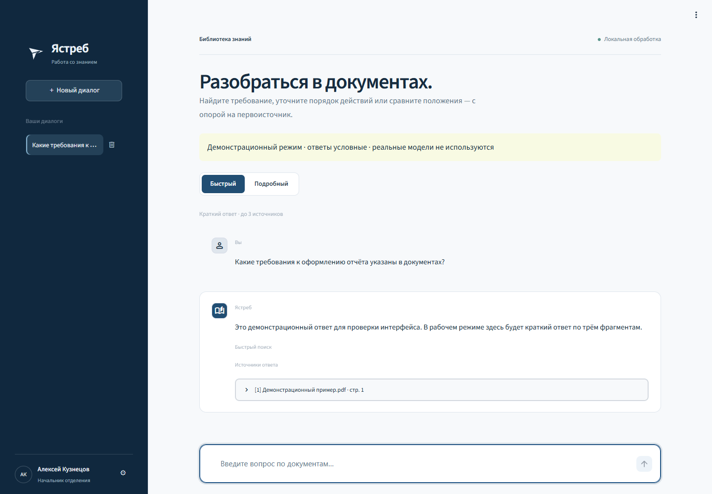

# Ястреб

Текущая версия: **2.2.1**. Изменения: [CHANGELOG.md](CHANGELOG.md).

## Установка на Windows — один запуск

1. Скачайте архив исходников из [последнего релиза](https://github.com/fads25d-debug/YastrebRAG/releases/latest).
2. Полностью распакуйте ZIP в постоянную папку с правом записи, например `C:\Yastreb` (не запускайте внутри ZIP).
3. Запустите **`install.cmd`**. Он сам подготовит Python 3.12, зависимости, Ollama,
   BGE-M3, Qwen2.5:7b и локальный OCR (русский/английский), затем проверит распознавание,
   загрузку PDF, индексацию и реальный ответ.
4. В открывшемся браузере укажите почту, имя и пароль первого администратора.
   Дальше запускайте **`start.cmd`**.

Нужны Windows 10/11 x64, Интернет для первой установки, не менее 16 ГБ ОЗУ
и рекомендуется 30 ГБ свободного места с учётом архивов и зависимостей.
Скачивается несколько гигабайт: оставьте окно открытым до завершения.
Python и Ollama вручную устанавливать не нужно. После подготовки работа автономная.
При отсутствии Microsoft Visual C++ Runtime установщик предложит системное
подтверждение Windows (UAC); иногда после этого нужна перезагрузка и повторный запуск.
Настройка администратора доступна только локально и только при пустой базе пользователей;
существующие пользователи, документы и диалоги не удаляются.

При ошибке установка останавливается: журнал находится в `data/logs/install-*.log`.
Повторный запуск использует уже загруженные проверенные архивы. Перед обновлением
закройте приложение. Windows-версия использует отдельный локальный порт Ollama **11435**;
другую копию Ястреба на этом порту нужно сначала закрыть. Эмбеддинги и генерация
по умолчанию работают на CPU, чтобы не зависеть от видеокарты и CUDA-драйвера.
Файлы PDF/DOCX/PPTX поддерживаются сразу. Для старых DOC/PPT и просмотра оригинальных
слайдов установите LibreOffice отдельно; он не входит в автоматическую установку.

## Интерфейс



Скриншот работающего приложения в демонстрационном режиме: данные и ответ условные.
Слева — история диалогов, пользователь и настройки; в основной области — быстрый
и подробный режимы, переписка и раскрываемые источники. Управление библиотекой
доступно пользователям с соответствующими правами через **⚙ → Внести изменения**.

## Сканы PDF и распознавание текста (OCR)

Страницы без текстового слоя автоматически распознаются локальным Tesseract на русском
и английском. Смешанные PDF поддерживаются: полноценный текстовый слой используется
напрямую; скан с короткой подписью или номером страницы также проходит OCR.
Оригинал не изменяется; распознанный текст сохраняется отдельно с номерами страниц,
поэтому источники открывают нужную страницу исходного скана. Ошибки OCR возможны:
сверяйте цитаты с изображением, особенно числа, таблицы и плохие копии.

При загрузке отображается прогресс по страницам, затем по фрагментам индекса.
Не закрывайте страницу настроек во время импорта. Книга на сотни страниц может
обрабатываться долго на CPU. Повторная индексация использует сохранённый текст;
повторное добавление того же файла не запускает OCR заново.
Если на непустой странице OCR не находит текст, импорт показывает предупреждение
с номером страницы. Оно сохраняется вместе с документом и доступно в просмотрщике;
проверьте, иллюстрация это или непрочитанный скан. Белые страницы предупреждения не вызывают.

Для обновления Windows закройте приложение и запустите `install.cmd` с Интернетом:
OCR и языки будут подготовлены в `tools/tesseract` без изменения системного PATH.
Дальнейшее распознавание полностью автономно. При первоначальной установке архивы
и языковые файлы проверяются по SHA256. Источники: [Tesseract](https://github.com/tesseract-ocr/tesseract/releases/tag/5.5.3),
[языки tessdata_fast](https://github.com/tesseract-ocr/tessdata_fast),
[7-Zip](https://www.7-zip.org/download.html). Проверка: `python -m scripts.check_ocr`.

В Linux нужны `tesseract-ocr`, `tesseract-ocr-rus`, `tesseract-ocr-eng`; установщик
запросит их через `sudo apt-get`, если они отсутствуют. Для нестандартной установки
задайте `YASTREB_TESSERACT` (полный путь к программе) и при необходимости
`YASTREB_TESSDATA` (каталог языков). Лимит PDF — 2000 страниц и прежние 50 МиБ;
OCR одной страницы ограничен 120 секундами, изображение — 12 млн пикселей.
Для извлечения текста действуют ограничения распаковки: 8 МиБ на поток и 64 МиБ
на содержимое и ресурсы документа (без изображений). При превышении разделите PDF.
Защищённый паролем PDF нужно предварительно сохранить незашифрованным.

## Презентации: текст, таблицы и рисунки

Загружайте **PPTX/PPT** по отдельности или вместе с папкой документов.
PPTX читается без Microsoft Office: текстовые блоки и таблицы извлекаются по слайдам,
строки таблицы сохраняются, столбцы разделяются `|`. Первая строка таблицы передаётся
каждому поисковому фрагменту как контекст столбцов и показывается рядом с цитатой.
Из встроенных PNG/JPEG и других
поддерживаемых растровых изображений локальный OCR извлекает надписи, учитывая обрезку.
Таблица, вставленная картинкой, проходит OCR: её структура и числа требуют проверки.
Система **не описывает смысл рисунков, стрелок или схем** и не использует vision-модель.
Внешние изображения по ссылкам не скачиваются. Непрочитанные изображения отмечаются
предупреждением с номером слайда. Встроенные диаграммы/SmartArt также отмечаются как
неиндексируемые: для OCR надписей вставьте их растровую копию. Анимация и заметки
докладчика не индексируются.

Источники указывают **номер слайда**, а ссылка открывает сохранённый текст с выделением
фрагмента. При установленном LibreOffice дополнительно отображается оригинальный
слайд, доступны навигация и скачивание презентации. Без него текст PPTX и скачивание
работают; просмотрщик объясняет, как включить визуальное отображение.

Для **PPT** и визуального просмотра установите [LibreOffice](https://www.libreoffice.org/download/download-libreoffice/)
на сервере; на Astra нужен пакет `libreoffice-impress` из разрешённого репозитория.
При нестандартном пути задайте `YASTREB_LIBREOFFICE` — полный путь к `soffice.exe`/`soffice`.
Преобразование выполняется локально в отдельном временном профиле с максимальным
уровнем защиты от макросов. PPTX с внешними ресурсами не преобразуется для предпросмотра.
Если установка LibreOffice невозможна, сохраните старый PPT как PPTX заранее.

Оригинал и извлечённый текст сохраняются в `data/library`; повторная индексация
использует этот снимок без повторного OCR. Лимит — 2000 слайдов, 50 МиБ на файл,
100 МиБ распакованного содержимого и 4 млн символов извлечённого текста. Строку
таблицы длиннее 1000 символов необходимо разделить: программа сообщит об этом,
чтобы не потерять соответствие столбцов. Ошибки отдельного файла не прерывают импорт папки.

## Папка с документами и переход к источнику

Войдите как администратор или начальник отделения: **⚙ → Внести изменения →
Выбрать папку целиком**. Выберите папку на своём компьютере, подтвердите добавление
и нажмите **«Добавить и проиндексировать»**. Браузер передаст PDF/DOCX/DOC/PPTX/PPT из папки
и вложенных папок на локальный сервер Ястреба. В режиме отдельных файлов можно
выбрать несколько документов. Все пользователи затем смогут искать по общей библиотеке.

Лимиты: 1000 файлов / 500 МиБ за импорт, до 50 МиБ на файл. Дубликаты содержимого
не добавляются повторно; повреждённые или неподдерживаемые документы показываются
в отчёте, остальные индексируются. Относительные пути папок сохраняются в названиях
источников. Изменения исходной папки не отслеживаются автоматически: для добавления
новых версий повторите импорт. Предыдущие версии остаются в библиотеке.

Под ответом раскройте источник и нажмите **«Открыть найденный фрагмент ↗»**.
PDF открывается на нужной странице: показаны оригинальная страница и текст с
выделенным фрагментом. Word открывается на нужном абзаце, включая абзацы из таблиц;
доступны соседние абзацы, навигация и скачивание оригинала. Нумерация Word относится
к абзацам, не к печатным страницам. Просмотр Word текстовый, без воспроизведения
исходной вёрстки. Просмотр и скачивание требуют входа в систему.

DOCX читается без Word/LibreOffice. Для старых файлов **.doc** установите LibreOffice
на сервере (на Astra — пакет `libreoffice-writer` из разрешённого репозитория).
При необходимости задайте `YASTREB_LIBREOFFICE` — полный путь к `soffice`/`soffice.exe`.
Без LibreOffice файлы .doc попадут в отчёт ошибок; остальные документы обработаются.
Преобразование выполняется локально с отдельным профилем и отключёнными макросами.

При обновлении установите зависимости из `requirements.txt` (добавлен pypdfium2
для просмотра PDF) и перезапустите сервер. Существующие PDF сохраняются; один раз
переиндексируйте библиотеку для новых точных ссылок. Для старых ответов оригинал
находится по имени только при однозначном совпадении.

Поиск выполняется в серверной очереди: можно переключать диалоги или закрыть
страницу, ответ сохранится в исходной переписке. В одном диалоге допускается один
незавершённый запрос; разные диалоги обслуживаются последовательно. Для всей очереди
установлен предел 32 запроса. Сервер должен оставаться запущенным: после остановки
процесса незавершённые задания автоматически не возобновляются.

Публикуемый архив не содержит моделей, Ollama, рабочих документов, баз пользователей
или историй диалогов. На Windows `install.cmd` скачивает необходимые компоненты.
Для первичной установки без Интернета этот исходный архив не предназначен.

Локальный помощник по PDF (включая сканы), Word и PowerPoint: Streamlit, ChromaDB, sentence-transformers, Ollama, Tesseract OCR.
Режим **Быстрый** использует до 3 фрагментов и даёт краткий ответ; **Подробный** — до 8 фрагментов и развёрнутое объяснение.
Размер фрагмента 1000 символов, перекрытие 200. Источники показывают имя файла, физическую страницу PDF, абзац Word или слайд презентации (с 1) и проверенную цитату.

## Обычный запуск на этом компьютере

Дважды нажать `start.cmd`: браузер откроется автоматически по адресу http://127.0.0.1:8502. Войдите в свою учётную запись.
Повторный запуск открывает уже работающий интерфейс. Скрипт совместим с Windows PowerShell 5.1; запрос регистрационной почты Streamlit отключён.
Окно запуска нужно оставить открытым во время работы. Для библиотеки: шестерёнка → «Внести изменения» → выбрать документы или папку → подтвердить → «Добавить и проиндексировать».
Файлы автоматически сохраняются и индексируются; затем можно задавать вопросы. Кнопка «Переиндексировать» нужна для повторного построения базы или смены модели эмбеддингов.
Модель возвращает номера использованных фрагментов. Программа проверяет эти номера и подставляет оригинальный текст фрагментов из PDF в блоки источников; перепечатывать цитаты модели не требуется. Это исключает ложный отказ из-за исправления моделью разорванных слов PDF. Неизвестные номера источников отклоняются. Отсутствующие в тексте ссылки на заявленные источники добавляются автоматически.
Для вопросов «Что такое …» и «Что за …», если предмет совпадает с названием файла (в том числе с пробелами внутри названия), поиск добавляет до двух подходящих фрагментов с первых трёх страниц. Общий предел остаётся 3/8 фрагментов. Это помогает получить общее описание вместо отдельных технических разделов.
Автонаблюдение Streamlit за файлами отключено: оно вызывало ошибочные импорты необязательных модулей Transformers. После изменения кода приложение нужно перезапустить.
Запуск останавливается с понятным сообщением, если Ollama или выбранная модель недоступны; Интернет для запуска не нужен после подготовки моделей.

## Запуск для проверки интерфейса

На этой машине уже создано окружение `.venv`. Из каталога проекта:

```powershell
./start.ps1 -Demo
```

Открыть http://127.0.0.1:8501. Деморежим явно помечен: ответы условные, PDF не индексируются.
В шестерёнке → «Профиль» можно переключать тестовую роль. История каждой роли хранится отдельно в `data/demo`.
Демо предназначено для локальной проверки, не публикуйте его в корпоративной сети.

## Установка на другую машину

Для переноса на Astra Linux с Интернетом при первой установке см. [ASTRA.md](ASTRA.md).
В комплекте для Astra используются `install-astra.sh` и `start-linux.sh`; Windows `.venv` не переносится.

Python 3.10+, проверено на Python 3.12 Windows. Команды Windows:

```powershell
python -m venv .venv
.venv/Scripts/python.exe -m pip install -r requirements-dev.txt
```

На Linux: `python3 -m venv .venv`, далее использовать `.venv/bin/python` вместо `.venv/Scripts/python.exe`.
Для эксплуатации достаточно `requirements.txt`. `requirements-lock.txt` фиксирует полное проверенное окружение Windows/Python 3.12, если этот файл присутствует; для другой платформы используйте верхнеуровневые требования.

## Подготовка моделей (до отключения Интернета)

1. Установить Ollama с официального сайта и выполнить `ollama pull qwen2.5:7b`.
2. Скачать модель эмбеддингов в локальную папку (несколько ГБ):

```powershell
.venv/Scripts/python.exe -c "from huggingface_hub import snapshot_download; snapshot_download('BAAI/bge-m3', local_dir='models/bge-m3')"
```

Скачивание запускается оператором отдельно, само приложение модели не скачивает.
Ollama должен слушать только `127.0.0.1:11434` на сервере приложения. `qwen2.5:7b` можно заменить через переменную окружения.
Проверка готовности: `.venv/Scripts/python.exe -m scripts.check_environment`.

Для закрытого контура на машине с той же ОС, архитектурой и Python предварительно собрать колёса:

```powershell
.venv/Scripts/python.exe -m pip download -r requirements.txt -d wheelhouse
```

Перенести wheelhouse, проект, каталог `models/bge-m3` и подготовленные модели Ollama по разрешённому организацией процессу.
Установить: `python -m pip install --no-index --find-links wheelhouse -r requirements.txt`.
Проверить реальную работу с отключённым внешним сетевым доступом. Наличие локального URL само по себе не доказывает изоляцию; сетевые ограничения устанавливает администратор контура.

## Релиз и переносимые комплекты

Исходный релиз не включает большие модели и бинарники. Для публикации исходников:

```powershell
git archive --format=zip --output=dist/yastreb-rag-v2.2.1-source.zip v2.2.1
```

Переносимый комплект Astra создаётся из рабочего каталога скриптом `scripts/export_astra.py`;
готовый комплект содержит Linux-установщик, модели, библиотеку PDF и контрольные суммы.
Исходный комплект Windows требует Python 3.12, установки зависимостей через
`powershell -ExecutionPolicy Bypass -File install-windows.ps1`, а также отдельной
подготовки Ollama и моделей по инструкции выше. Сам установщик устанавливает только
Python-зависимости. Копия `.venv` не является переносимым Python для другой машины.
Не публикуйте комплекты с рабочими данными в GitHub:
в них могут быть документы и база учётных записей.

## Рабочий режим и пользователи

На текущем компьютере Ollama размещён в `tools/ollama`, модели — в `models/ollama` и `models/bge-m3`.
`start.ps1` запускает локальный Ollama при необходимости. Первый администратор может установить пароль через локальную форму:

```powershell
./start.ps1 -SetupEmail 'admin@company.local' -Port 8502
```

Форма доступна только при пустой базе пользователей и адресе сервера `127.0.0.1`. После создания администратора она закрывается; роль нельзя выбрать самостоятельно. Далее вход по почте и установленному паролю.

Учётные записи создаются администратором сервера, пароль вводится скрыто:

```powershell
.venv/Scripts/python.exe -m yastreb.manage add-user --email head@company.local --name "Начальник отделения" --role branch_head
.venv/Scripts/python.exe -m yastreb.manage add-user --email worker@company.local --name "Работник" --role worker
./start.ps1
```

Вход — корпоративная почта и локальный пароль; это не интеграция с почтовым сервером/AD.
Пароли хешируются PBKDF2-SHA256 с индивидуальной солью; после пяти неудач вход блокируется на пять минут.
Сессия требует повторного входа после 30 минут бездействия.

| Роль | Поиск и личная история | Загрузка и переиндексация |
|---|---|---|
| worker | Да | Нет |
| branch_head | Да | Да |
| admin | Да | Да |

Управление пользователями пока выполняется серверной CLI, не веб-формой. Клиент не выбирает собственную роль в рабочем режиме.
Настройки раскрываются вверх над именем пользователя внутри боковой панели. «Внести изменения» доступна только разрешённым ролям; право проверяется сервером заново при нажатии.
Загрузка требует подтверждения. Все пользователи имеют доступ к общей библиотеке; ограничения чтения по отделениям не реализованы.
История хранится в SQLite с проверкой владельца на чтение и запись. При выходе из аккаунта интерфейс сессии очищается.

## Конфигурация

Переменные задаются в оболочке до запуска (`$env:ИМЯ='значение'` в PowerShell). `.env` автоматически не читается.

| Переменная | По умолчанию |
|---|---|
| YASTREB_DATA_DIR | data рядом с app.py |
| YASTREB_EMBEDDING_PATH | models/bge-m3 |
| YASTREB_OLLAMA_URL | http://127.0.0.1:11434 |
| YASTREB_OLLAMA_MODEL | qwen2.5:7b |
| YASTREB_DEMO | 0 |
| YASTREB_NUM_GPU | start.ps1 задаёт 0 (CPU); можно указать число GPU-слоёв |

При изменении модели эмбеддингов перестройте индекс. Не используйте несовместимые эмбеддинги с ранее построенным индексом.
Документы, поколения индекса и учётные записи находятся в `data`; ограничьте права на этот каталог.
Резервное копирование — остановить приложение и скопировать весь `data` вместе с конфигурацией модели.

## Развёртывание в локальной сети

По умолчанию интерфейс слушает только loopback. Для корпоративного доступа используйте внутренний HTTPS reverse proxy к `127.0.0.1:8501` с поддержкой WebSocket. TLS нужен для защиты паролей в сети.
Приложение проверяет локальные учётные записи; заголовки `X-Forwarded-User` не предоставляют права.
Не открывайте Chroma или Ollama клиентам сети. Один экземпляр приложения, одна локальная файловая система; кластерное развёртывание не входит в MVP.
Интеграция с корпоративным SSO/AD требует сведений об инфраструктуре организации и отдельной настройки.

## Проверки и ограничения

```powershell
.venv/Scripts/python.exe -m pytest -q
.venv/Scripts/python.exe -m compileall yastreb app.py scripts
.venv/Scripts/python.exe -m scripts.check_environment
.venv/Scripts/python.exe -m scripts.smoke_rag
```

Автотесты проверяют роли, изоляцию истории, сценарии интерфейса и backend. Тесты с подменёнными модельными границами не доказывают качество реальной LLM.
`smoke_rag` запускается отдельно с настоящими моделями и создаёт изолированную библиотеку `data/smoke` с вымышленным тестовым PDF; рабочую библиотеку не изменяет.
Для приёмки нужны реальные PDF и модели: проверить вопросы с ответом, без ответа, противоречащие документы, точность страниц и цитат, два режима и отказ работнику в загрузке.

Ограничения: OCR может ошибаться на плохих сканах и рукописном тексте; таблицы PDF могут извлекаться с потерей структуры; Top-8 не является анализом всех документов; каждый вопрос выполняет самостоятельный поиск (контекст прошлой беседы не добавляется).
Цитаты проверяются по найденному тексту, но их корректность не гарантирует правильность всех выводов модели. Ответы необходимо сверять с источниками.
Скорость 5–15 секунд не гарантируется: измеряется на фактическом CPU/GPU и наборе документов.
На текущей GTX 1050 Ti (4 ГБ) Ollama 0.34.0 выдаёт ошибку инициализации CUDA, поэтому запуск настроен на CPU. Для другого GPU можно задать `YASTREB_NUM_GPU`; перед эксплуатацией следует проверить драйвер и выполнить сквозной тест.
